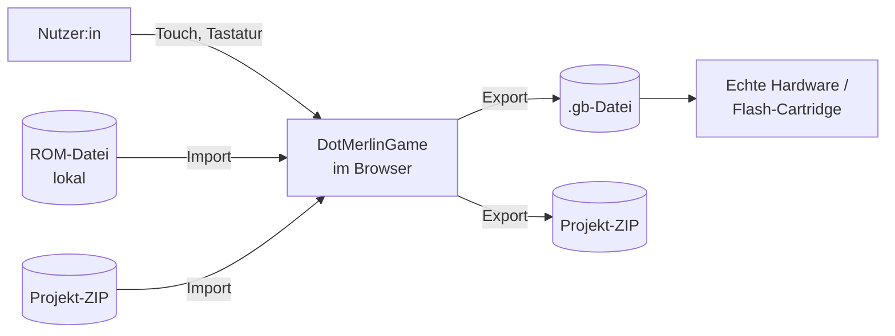

# 3. Kontextabgrenzung

## 3.1 Fachlicher Kontext

| Partner | Eingabe | Ausgabe |
|---|---|---|
| Nutzer:in | Touch-Gesten, Tastatur, Quelltext, Controller-Eingaben | Darstellung in quadratischen Views |
| Lokale ROM-Datei | `.gb`-Datei aus dem Dateisystem des Geräts | – (wird einmalig disassembliert, ab M3) |
| Projekt-ZIP | Quelltext und Projektdaten | Quelltext und Projektdaten |
| `.gb`-Export | – | Build-Ergebnis mit gültigem Header für echte Hardware |

## 3.2 Technischer Kontext

| Schnittstelle | Technik | Bemerkung |
|---|---|---|
| Dateizugriff | Browser-Datei-APIs (Auswahl, Download) | Daten verlassen das Gerät nur durch bewussten Export |
| Persistenz | IndexedDB im Browser | Kein Server |
| Auslieferung der App | Statisches Hosting, vorerst Replit | Nur statische Dateien, kein Backend. Danach keine Netzwerkzugriffe zur Laufzeit nötig |
| Tonausgabe | Audio-Ausgabe des Browsers | Freigabe erst nach erster Nutzeraktion |
| Offline | Service Worker | Erst ab M7 oder hinter Build-Flag |

Es gibt keine Laufzeit-Schnittstellen zu externen Diensten.
