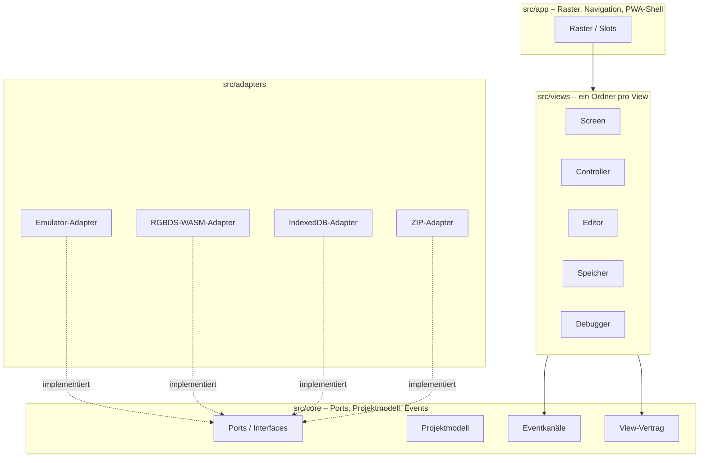
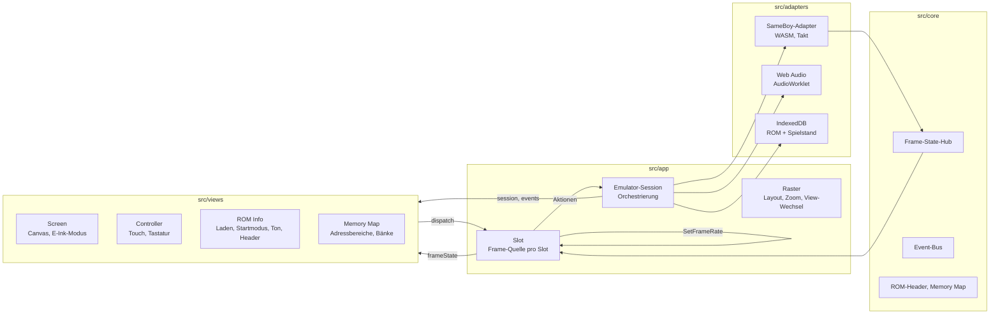

# 5. Bausteinsicht

## 5.1 Ebene 1: Gesamtsystem



| Baustein | Verantwortung | Meilenstein |
|---|---|---|
| `src/core/` | Ports (Interfaces) für Emulator, Assembler, Speicher und ZIP. Projektmodell. Eventkanäle. View-Vertrag. Frei von Fremdcode und UI-Framework. | M0 (Interfaces) |
| `src/adapters/` | Implementierungen der Ports mit Fremdkomponenten (Emulator-Core, RGBDS-WASM, IndexedDB, ZIP-Bibliothek) | ab M1 |
| `src/views/` | Ein Ordner pro View. Liest nur Zustand, schreibt nur über den Aktionskanal. | ab M1 |
| `src/app/` | Raster, Navigation, Kopfleisten, Theme und Design-Tokens, PWA-Shell, Build-Version | M0 |
| `third_party/` | Herkunftsnachweise (Quelle, Version, Lizenz, Commit-Hash) | M0 |
| `tests/` | Roundtrip, Boot-Zustand, View-Vertrag | M0 (Rahmen) |
| `examples/` | Selbst geschriebene, lizenzfreie Beispielprojekte | M2 |

## 5.2 Ebene 2: Zentrale Schnittstellen in `src/core/`

### View-Vertrag

Unabhängig vom UI-Framework als TypeScript-Interfaces definiert, umgesetzt in React.

- **Ein View erhält:** aktuelle Größe, read-only abonnierbaren Emulator-Zustand, Projektzustand, Kanal für Aktionen (z. B. "Breakpoint setzen").
- **Ein View liefert:** eigenen, serialisierbaren Zustand (für das Layout), Titel und Icon für die Kopfleiste.

### Eventmodell

| Kanal | Inhalt | Frequenz | Zugriff |
|---|---|---|---|
| Frame-Zustand | Snapshot pro Frame: Register, Flags, Zyklen, geänderte Speicherbereiche | hoch, konfigurierbar (volle Rate, reduziert, auf Anforderung) | Views ziehen nur, was sie brauchen, nur wenn sichtbar (`useSyncExternalStore`) |
| Diskrete Ereignisse | Getypte Union, z. B. `BreakpointHit`, `BuildFinished`, `RomLoaded`, `ProjectChanged` | selten | Abonnement, typisiert, ohne freie Strings |

Die Interfaces beider Kanäle entstehen in M0, die Umsetzung in M1.

### Ports

| Port | Zweck | Adapter (geplant) |
|---|---|---|
| Emulator | Laden, Ausführen, Step, Breakpoints, Zustand lesen, Tonausgabe (DMG-01), Batterie-RAM | SameBoy-Adapter (ADR-0006) |
| ROM-Speicher | genau ein ROM samt Spielstand (M1-Übergang, ADR-0005) | IndexedDB |
| Tonausgabe | Samples abspielen, Lautstärke, Stumm, Füllstand | Web Audio (AudioWorklet) |
| Assembler | `rgbasm` → `rgblink` → `rgbfix`, liefert ROM, Symbol- und Map-Datei | RGBDS-WASM |
| Projektspeicher | Projekte lesen und schreiben | IndexedDB |
| Archiv | Projekte als ZIP exportieren und importieren | MIT-lizenzierte ZIP-Bibliothek |

Debug-Zugriff: Der SameBoy-Core bietet Ausführungs-, Lese- und Schreib-Hooks (ADR-0006). In M1 sind `step` und Breakpoints im Port deklariert, die Umsetzung folgt in M4.

## 5.3 Umsetzungsstand M0

```text
src/
├── config/project.ts      PROJECT_NAME (einzige Stelle im Code)
├── core/                  frameworkfrei, per ESLint abgesichert
│   ├── types.ts           Unsubscribe, JsonValue, Button
│   ├── events/            frame-state.ts (Kanal 1), domain-events.ts (Kanal 2)
│   ├── view/              view-contract.ts, view-actions.ts
│   ├── ports/             emulator.ts, assembler.ts, project-store.ts, archive.ts
│   ├── layout/            layout-state.ts
│   └── index.ts           öffentliche Verträge
├── app/
│   ├── main.tsx           Einstieg
│   ├── shell/             AppShell, Footer (Build-Version)
│   ├── layout/            grid.ts (reine Rasterberechnung), Grid, Slot, SlotHeader
│   └── theme/             tokens.css, base.css
├── views/                 leer bis M1
└── adapters/              leer bis M1
build/                     build-version.ts, manifest-plugin.ts (nur Build-Zeit)
scripts/                   Lizenz-, Secret- und Icon-Skripte (nur Werkzeuge)
```

Die Verträge sind in M0 nur als Typen umgesetzt und durch Typ- und Vertragstests in `tests/contract/` abgesichert. Implementierungen der Ports folgen ab M1 in `src/adapters/`.

## 5.4 Umsetzungsstand M1



| Baustein | Ort | Verantwortung |
|---|---|---|
| SameBoy-Adapter | `src/adapters/emulator/sameboy/` | `EmulatorPort` auf dem WASM-Core (ADR-0006): ROM laden, Startmodi, Hardware-nah-Halt, Snapshots mit Bild (Graustufen-Indizes) und geänderten Speicherseiten, Batterie-RAM, Ton an `AudioSink`, Frame-Takt über `requestAnimationFrame` mit Taktung nach Audio-Füllstand |
| Eigene Boot-ROM | `src/adapters/emulator/bootrom/` | 256-Byte-Boot-ROM (ADR-0004), generiert nach `generated/dmg-boot.ts` |
| Web Audio | `src/adapters/audio/` | `AudioOutputPort`: AudioWorklet mit Ringpuffer, Ein- und Ausblenden, Lautstärke und Stumm per GainNode, kein `SharedArrayBuffer` |
| IndexedDB | `src/adapters/storage/` | `RomStorePort`: genau ein ROM samt Spielstand |
| ROM-Header, Memory Map | `src/core/rom/` | Header parsen, Ladeprüfung, Logo-Hash, Adressbereiche nach Pan Docs |
| Eventkanäle | `src/core/events/` | Event-Bus (Kanal 2), Frame-State-Hub mit verzögertem Snapshot-Aufbau (Kanal 1) |
| Emulator-Session | `src/app/session/` | einziger Empfänger der View-Aktionen: Laden, Ersetzen, Startmodus, Pause/Reset, Spielstand speichern, Pause im Hintergrund, Ton, Hinweise, Diagnose |
| Raster | `src/app/layout/` | Layout in `localStorage`, View-Wechsel per Pfeiltasten, Zoom-Schalter, Sichtbarkeit, Frame-Quelle pro Slot (Drosselung, keine Updates wenn verdeckt), Rate des Emulators nach Bedarf |
| Views | `src/views/` | `screen`, `controller`, `rom-info`, `memory-map`; lesen `frameState`/`session`, ändern nur über `dispatch` |

Abgesichert durch Unit-, Vertrags- und Emulator-Tests (`tests/unit`, `tests/contract`, `tests/emulator`,
`tests/boot-state`) mit selbst gebauten Test-ROMs (`tests/roms/src`) und durch Playwright-Abnahmetests
(`tests/e2e/m1-*.spec.ts`).
