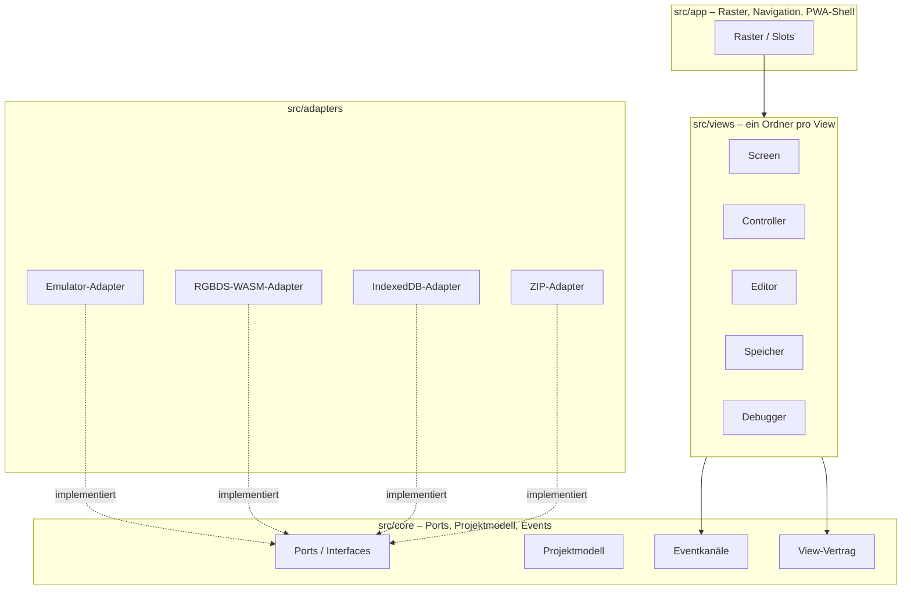

# 5. Bausteinsicht

## 5.1 Ebene 1: Gesamtsystem



| Baustein | Verantwortung | Meilenstein |
|---|---|---|
| `src/core/` | Ports (Interfaces) für Emulator, Assembler, Speicher und ZIP. Projektmodell. Eventkanäle. View-Vertrag. Frei von Fremdcode und UI-Framework. | M0 (Interfaces) |
| `src/adapters/` | Implementierungen der Ports mit Fremdkomponenten (Emulator-Core, RGBDS-WASM, IndexedDB, ZIP-Bibliothek) | ab M1 |
| `src/views/` | Ein Ordner pro View. Liest nur Zustand, schreibt nur über den Aktionskanal. | ab M1 |
| `src/app/` | Raster, Navigation, Kopfleisten, Theme und Design-Tokens, PWA-Shell, Build-Version | M0 |
| `third_party/` | Herkunftsnachweise (Quelle, Version, Lizenz, Commit-Hash) | M0 |
| `tests/` | Roundtrip, Boot-Zustand, View-Vertrag | M0 (Rahmen) |
| `examples/` | Selbst geschriebene, lizenzfreie Beispielprojekte | M2 |

## 5.2 Ebene 2: Zentrale Schnittstellen in `src/core/`

### View-Vertrag

Unabhängig vom UI-Framework als TypeScript-Interfaces definiert, umgesetzt in React.

- **Ein View erhält:** aktuelle Größe, read-only abonnierbaren Emulator-Zustand, Projektzustand, Kanal für Aktionen (z. B. "Breakpoint setzen").
- **Ein View liefert:** eigenen, serialisierbaren Zustand (für das Layout), Titel und Icon für die Kopfleiste.

### Eventmodell

| Kanal | Inhalt | Frequenz | Zugriff |
|---|---|---|---|
| Frame-Zustand | Snapshot pro Frame: Register, Flags, Zyklen, geänderte Speicherbereiche | hoch, konfigurierbar (volle Rate, reduziert, auf Anforderung) | Views ziehen nur, was sie brauchen, nur wenn sichtbar (`useSyncExternalStore`) |
| Diskrete Ereignisse | Getypte Union, z. B. `BreakpointHit`, `BuildFinished`, `RomLoaded`, `ProjectChanged` | selten | Abonnement, typisiert, ohne freie Strings |

Die Interfaces beider Kanäle entstehen in M0, die Umsetzung in M1.

### Ports

| Port | Zweck | Adapter (geplant) |
|---|---|---|
| Emulator | Laden, Ausführen, Step, Breakpoints, Zustand lesen, Tonausgabe (DMG-01) | Core nach ADR-0006 |
| Assembler | `rgbasm` → `rgblink` → `rgbfix`, liefert ROM, Symbol- und Map-Datei | RGBDS-WASM |
| Projektspeicher | Projekte lesen und schreiben | IndexedDB |
| Archiv | Projekte als ZIP exportieren und importieren | MIT-lizenzierte ZIP-Bibliothek |

Offener Punkt: Umfang des Debug-Zugriffs am Emulator-Port (Speicher-Watch, Schreib-Breakpoints, Bank-Info).

## 5.3 Umsetzungsstand M0

```text
src/
├── config/project.ts      PROJECT_NAME (einzige Stelle im Code)
├── core/                  frameworkfrei, per ESLint abgesichert
│   ├── types.ts           Unsubscribe, JsonValue, Button
│   ├── events/            frame-state.ts (Kanal 1), domain-events.ts (Kanal 2)
│   ├── view/              view-contract.ts, view-actions.ts
│   ├── ports/             emulator.ts, assembler.ts, project-store.ts, archive.ts
│   ├── layout/            layout-state.ts
│   └── index.ts           öffentliche Verträge
├── app/
│   ├── main.tsx           Einstieg
│   ├── shell/             AppShell, Footer (Build-Version)
│   ├── layout/            grid.ts (reine Rasterberechnung), Grid, Slot, SlotHeader
│   └── theme/             tokens.css, base.css
├── views/                 leer bis M1
└── adapters/              leer bis M1
build/                     build-version.ts, manifest-plugin.ts (nur Build-Zeit)
scripts/                   Lizenz-, Secret- und Icon-Skripte (nur Werkzeuge)
```

Die Verträge sind in M0 nur als Typen umgesetzt und durch Typ- und Vertragstests in `tests/contract/` abgesichert. Implementierungen der Ports folgen ab M1 in `src/adapters/`.
