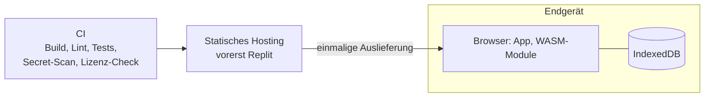
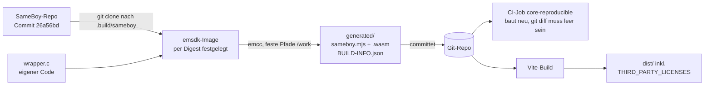

# 7. Verteilungssicht

## 7.1 Infrastruktur

| Knoten | Inhalt | Bemerkung |
|---|---|---|
| CI | Build, Lint, Typprüfung, Tests, Secret-Scan, Lizenz-Check | Muss grün sein, bevor etwas als fertig gilt |
| Statisches Hosting | Gebaute App (HTML, JS, CSS, WASM, Manifest, Icons) | Vorerst Replit. Nur statische Dateien, kein Backend; Hoster jederzeit austauschbar |
| Endgerät | App im Browser, Emulator und Assembler als WASM, Daten in IndexedDB | Keine Daten verlassen das Gerät |

## 7.2 Betriebsmodi

| Modus | Service Worker | Bemerkung |
|---|---|---|
| Dev-Server (`npm run dev`) | aus | auch im WLAN über HTTP nutzbar, kein Cache-Problem |
| Test-Build | aus | |
| Produktion bis M6 | aus (höchstens hinter Build-Flag) | nur Manifest und Icons |
| Produktion ab M7 | an | versionierte Caches, Hinweis "Update verfügbar", Button "Cache leeren / Neu laden" |

Die Build-Version (Commit-Hash) ist immer in der Oberfläche sichtbar, damit am Gerät erkennbar ist, welcher Stand läuft. Service Worker brauchen HTTPS oder localhost.

**Replit-Entwicklung:** Node.js 24 ist in `.replit` eingerichtet. Der Run-Workflow
`Start application` startet `npm run dev` auf `0.0.0.0:5000`. Vite akzeptiert
Proxy-Hosts; `strictPort` verhindert einen unbemerkten Portwechsel. Es werden
keine Backend-Dienste oder Secrets benötigt. Einrichtung und Prüfbefehle stehen
in `replit.md`. Der Playwright-Preview-Server verwendet separat Port 4173.

## 7.3 Emulator-Core: Herkunft und Bauweg

Der Emulator-Core ist ein Binärartefakt im Repo. Woher er stammt und wie er entsteht, muss ohne
Vorwissen nachvollziehbar sein ([ADR-0006](../adr/0006-emulator-core.md)).

| Eigenschaft | Wert |
|---|---|
| Quelle | https://github.com/LIJI32/SameBoy |
| Version | Release v1.0.4, Commit `26a56bd6a122a6318a456abd80558408742d5adf` |
| Lizenz | Expat (SPDX `MIT`), Text in `third_party/licenses/sameboy-LICENSE` |
| Verwendet | nur `Core/`: `gb.c`, `sgb.c`, `apu.c`, `memory.c`, `mbc.c`, `timing.c`, `display.c`, `camera.c`, `sm83_cpu.c`, `joypad.c`, `save_state.c`, `random.c`, `rumble.c`, `printer.c`, `workboy.c` |
| Nicht verwendet | `BootROMs/`, `iOS/`, `HexFiend/`, Frontends, Debugger, Rewind, Cheats |
| Eigener Code | `src/adapters/emulator/sameboy/wrapper.c` (MIT), keine Änderungen am Core |
| Compiler | Emscripten 6.0.11 im Image `emscripten/emsdk@sha256:cdefec943f04fd4b2b2fe23b0a1a346be9fc560ef5784a83faa27dd351381372` |
| Flags | `-O3 -std=gnu11 -D_GNU_SOURCE -DGB_INTERNAL -DGB_DISABLE_TIMEKEEPING -DGB_DISABLE_REWIND -DGB_DISABLE_DEBUGGER -DGB_DISABLE_CHEATS -DGB_DISABLE_CHEAT_SEARCH`, `GB_VERSION` = SameBoy-Commit; Linker: `MODULARIZE`, `EXPORT_ES6`, `ENVIRONMENT=web,node`, `FILESYSTEM=0`, `ALLOW_MEMORY_GROWTH`, explizite Exportliste |
| Gelinkte Laufzeit | `libc.a` (musl, MIT), `libdlmalloc.a` (CC0), `libstubs.a` (Emscripten, MIT/NCSA), siehe `third_party/emscripten.md` |
| Ausgabe | `src/adapters/emulator/sameboy/generated/sameboy.mjs`, `sameboy.wasm`, `BUILD-INFO.json` (Commit, Image, Flags, SHA-256) |
| Skript | `scripts/build-core.sh` (`npm run core:build`) |

**Prüfung**: Der erste Lauf auf GitHub Actions (2026-10-18, Run 39152511283) hat das committete Artefakt byte-identisch nachgebaut. Der CI-Job `core-reproducible` baut mit demselben Skript neu und schlägt fehl, sobald sich das
Ergebnis vom committeten Artefakt unterscheidet (`npm run core:verify`). `tests/unit/build-info.test.ts`
prüft, dass Commit und Image in Skript, `BUILD-INFO.json` und `third_party/` übereinstimmen und die
SHA-256-Werte zu den Dateien passen.

**Core aktualisieren**:

1. Neuen Commit wählen und die LICENSE-Datei dieses Commits lesen.
2. `SAMEBOY_COMMIT` (und bei Bedarf `EMSDK_IMAGE` mit neuem Digest) in `scripts/build-core.sh` ändern.
3. `npm run core:build` ausführen und die Link-Ausgabe `.build/link-trace.txt` auf neue System-Bibliotheken
   prüfen.
4. `third_party/sameboy.md` und `third_party/emscripten.md` (Front Matter und Text), bei Bedarf
   `third_party/licenses/*`, dann `npm run licenses:generate`.
5. `npm test` und `npm run check`, danach Artefakt, `BUILD-INFO.json`, `third_party/` und
   `THIRD_PARTY_LICENSES` **in einem Commit**.

**Eigene Boot-ROM**: Sie entsteht aus `src/adapters/emulator/bootrom/dmg-boot.asm` mit RGBDS v1.0.4
(Linux-x86_64-Release, SHA-256 `3e19e50ea602e316be709160acaf0a708b1fa6d32d219ec541f244442895dbb7`, geladen
von `scripts/fetch-rgbds.ts` nach `.tools/`). Ausgabe ist `src/adapters/emulator/bootrom/generated/`.
`npm run check` baut sie neu und prüft per `git diff` ([ADR-0004](../adr/0004-boot-rom-strategie.md)).

## 7.4 Auslieferung und Gerätetests

| Weg | Quelle | Einstellungen | Zweck |
|---|---|---|---|
| Replit (statisches Deployment) | Branch `main` | Build-Befehl `npm run build`, Ausgabeordner `dist` | Gerätetests und Abnahme am Smartphone und auf E-Ink |
| Dev-Server im Codespace | jeder Branch | `npm run dev`, Port 5173 weitergeleitet | Schnelle Sichtprüfung vor dem Merge |

- Nach `main` kommt nur, was auf dem Feature-Branch eine grüne CI hat. Der Merge erfolgt als
  Fast-Forward.
- Der Build braucht weder Docker noch RGBDS. Core und Boot-ROM liegen gebaut im Repo (7.3).
- Der weitergeleitete Codespace-Port ist privat, die Geräte brauchen also eine GitHub-Anmeldung. Vite
  akzeptiert den fremden Host nur, wenn man ihn für den Lauf freigibt:
  `__VITE_ADDITIONAL_SERVER_ALLOWED_HOSTS=.app.github.dev npm run dev`. Die Projekt-Config bleibt
  unverändert.
- Leistungswerte (z. B. SC-002 in M1b) werden nur am Produktions-Build gemessen (Replit oder
  `npm run preview`), nie am Dev-Server.
