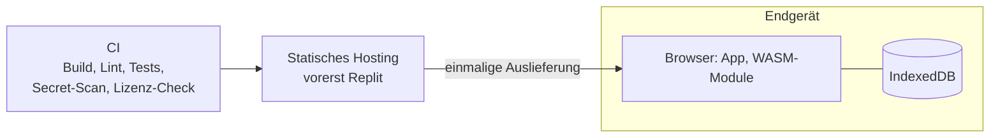

# 7. Verteilungssicht

## 7.1 Infrastruktur

| Knoten | Inhalt | Bemerkung |
|---|---|---|
| CI | Build, Lint, Typprüfung, Tests, Secret-Scan, Lizenz-Check | Muss grün sein, bevor etwas als fertig gilt |
| Statisches Hosting | Gebaute App (HTML, JS, CSS, WASM, Manifest, Icons) | Vorerst Replit. Nur statische Dateien, kein Backend; Hoster jederzeit austauschbar |
| Endgerät | App im Browser, Emulator und Assembler als WASM, Daten in IndexedDB | Keine Daten verlassen das Gerät |

## 7.2 Betriebsmodi

| Modus | Service Worker | Bemerkung |
|---|---|---|
| Dev-Server (`npm run dev`) | aus | auch im WLAN über HTTP nutzbar, kein Cache-Problem |
| Test-Build | aus | |
| Produktion bis M6 | aus (höchstens hinter Build-Flag) | nur Manifest und Icons |
| Produktion ab M7 | an | versionierte Caches, Hinweis "Update verfügbar", Button "Cache leeren / Neu laden" |

Die Build-Version (Commit-Hash) ist immer in der Oberfläche sichtbar, damit am Gerät erkennbar ist, welcher Stand läuft. Service Worker brauchen HTTPS oder localhost.
